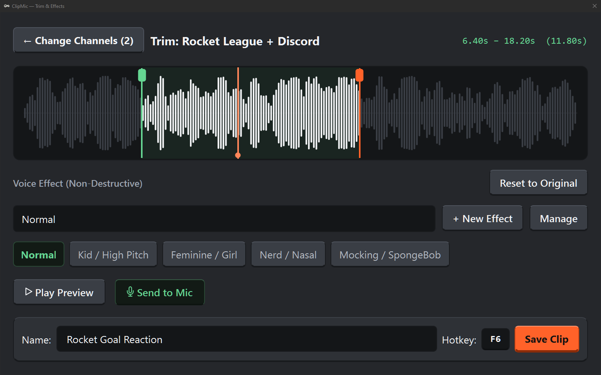
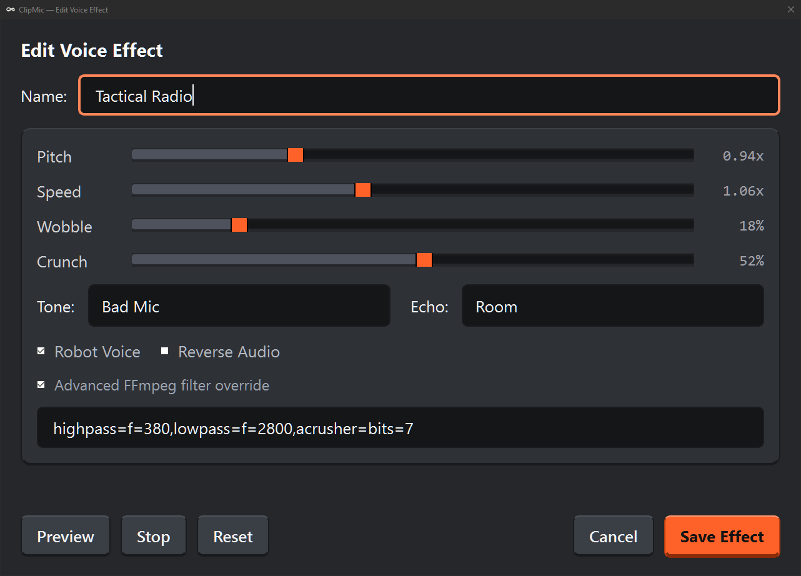

# ClipMic

[](LICENSE)
[](#download--install)
[](https://github.com/3bdyna/clipmic/releases/latest)

**A lightweight Windows soundboard, rolling per-app audio clipper, and Direct Mic APO injector — no virtual audio cables required.**

> **Note:** I am not a professional programmer — I vibe-coded ClipMic with AI because I wanted a clean, lightweight Windows soundboard and audio clipper that injects directly into my microphone without messing with virtual audio cables. Expect features that totally are NOT bugs.


---

## Why ClipMic?

Most soundboards force you to install virtual audio cables and re-route half of Windows just to play a clip to friends in Discord or in-game. **ClipMic** injects audio straight into your real physical microphone via a lightweight Windows Audio Processing Object (`clipmic_apo.dll`), while continuously keeping a rolling audio buffer of your games, apps, and mic so you can clip funny moments right after they happen.

### Key Features

- **Direct Mic Injection (No Virtual Cables):** Play clips straight through your real microphone using the bundled Windows APO (`clipmic_apo.dll`), with separate **Clip Mic** and **Speaker Monitor** volume sliders.
- **Rolling Per-App & Mic Audio Buffer:** Continuously buffers the last **5–180 seconds** per active app or game via Windows Process Loopback (`clipmic_procloop.dll`) alongside an optional microphone track, with automatic WASAPI loopback fallback.
- **Instant Fast Clip (`F8`) & Channel Picker (`F9`):** Press `F8` to grab and save the last few seconds instantly, or hit `F9` to freeze the rolling buffer and choose exactly which apps or mic channels to keep.
- **Non-Destructive Trimming & FFmpeg Voice Effects:** Trim clips visually on an interactive waveform, apply built-in or custom FFmpeg voice effects, bind global soundboard hotkeys, drag-and-drop audio/video files to import, or export to MP3.
- **English & Arabic (RTL) UI:** Live language toggle with full right-to-left (RTL) layout support, dark native Windows title bars, and system tray integration.
- **Built-In SHA-256 Verified Updater:** Checks GitHub Releases quietly in installed builds and verifies every download against `SHA256SUMS.txt` before updating in-place.
- **100% Local & Private:** No accounts, no telemetry, no analytics, and no online downloaders — your audio never leaves your PC.

---

## Closer Look

### 1. Pick Exactly Which App or Mic to Clip (`F9`)
When something funny happens, hit `F9` to freeze the rolling buffer. Preview individual game, app, and microphone tracks on mini-waveforms and mix only the channels you want.


### 2. Trim Waveforms & Bind Hotkeys
Drag the trim handles to dial in the exact moment, test built-in or custom voice presets, preview on speakers or send straight to your mic, and assign a global soundboard hotkey.



### 3. Build Custom FFmpeg Voice Effects
Tweak pitch, speed, wobble, crunch, tone, and echo with live clip preview — or expand the advanced FFmpeg filter override to craft your own sound.



---

## Download & Install

1. Grab the latest installer (`ClipMic-Setup-*.exe`) from [**GitHub Releases**](https://github.com/3bdyna/clipmic/releases/latest).
2. Run `ClipMic-Setup-*.exe` for a clean per-user install (no admin rights needed unless you click **Enable Direct Mic** inside the app).

> **Windows SmartScreen Note:** Because ClipMic is an unsigned indie app, Windows Defender SmartScreen may show a *"Windows protected your PC"* prompt. Click **More info** → **Run anyway** to continue.

---

## Build / Run from Source

### Requirements
- Windows 10 (20H1+) or Windows 11
- Python 3.11+
- FFmpeg available on `PATH` (for effects processing, media import, and MP3 export)

### Quick Start & Tests
```powershell
pip install -r requirements.txt
python main.py
```

Run the unit test suite:
```powershell
$env:PYTHONPATH=".;tests"; python -m unittest test_clipmic -v
```

---

## License & Credits

Licensed under the **GNU General Public License v3.0 (GPL-3.0)** — see [LICENSE](LICENSE) and [THIRD_PARTY_NOTICES.txt](THIRD_PARTY_NOTICES.txt).

The Direct Mic APO technique was inspired by [Onion Board](https://github.com/Onion-Alien/onion-board).
