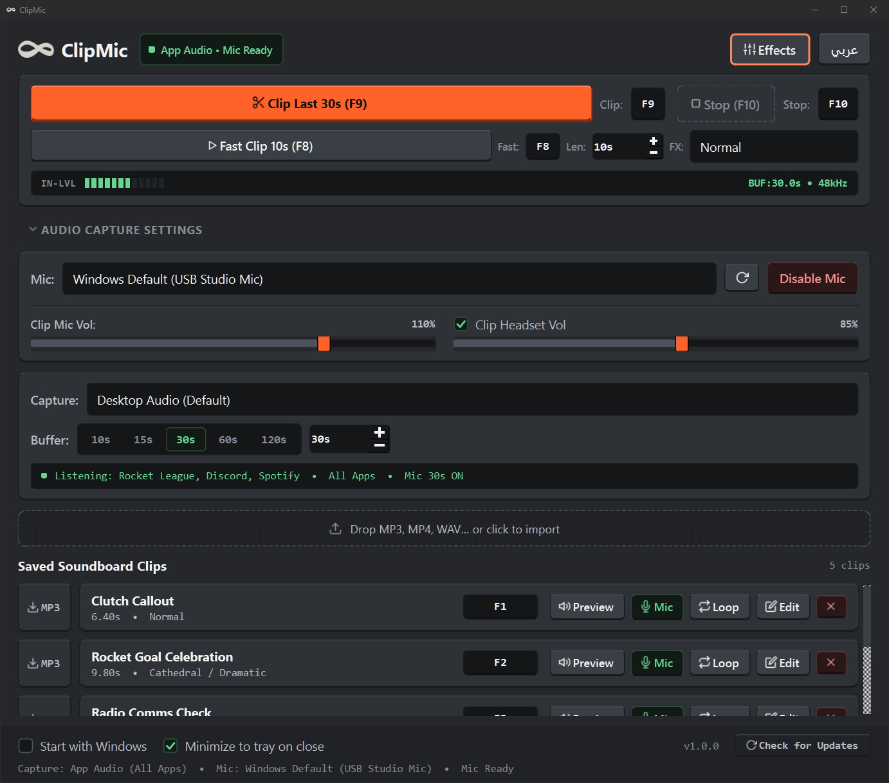
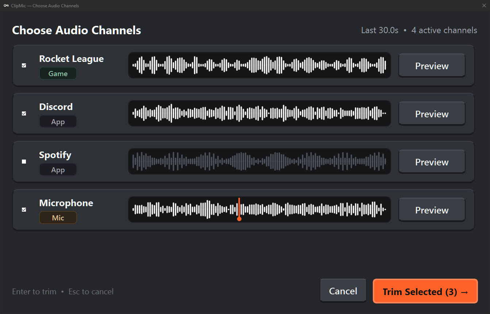

# ClipMic

[](LICENSE)
[](#download--install)
[](https://github.com/3bdyna/clipmic/releases/latest)

**ClipMic is a free, open-source Windows 10/11 soundboard, instant-replay audio clipper, and direct microphone audio injector — a lightweight, zero-telemetry alternative to Soundpad and Voicemod.**

[-0078D6?style=for-the-badge&logo=windows&logoColor=white)](https://github.com/3bdyna/clipmic/releases/latest)

> **100% local & offline** · No account · No ads · Zero telemetry · SHA-256 verified auto-updates



> **▶ [Watch the 20-second ClipMic Demo Video (1080p 60fps)](docs/media/clipmic-promo.mp4)**

---

## Features

- **Direct Microphone Audio Injection (No Virtual Audio Cables):** Play clips straight through your real physical microphone into Discord, games, and voice chat using ClipMic's DirectMic Windows APO (`clipmic_apo.dll`), with separate **Clip Mic** and **Speaker Monitor** volume controls.
- **Instant-Replay Rolling Audio Clipper (Per-App WASAPI):** Continuously buffer the last **5–180 seconds** of audio from individual apps or games via per-process WASAPI loopback capture (`clipmic_procloop.dll`) alongside an optional microphone track, with automatic system loopback fallback. Hit `F8` for an instant clip or `F9` to freeze the buffer and mix specific channels.
- **Global Hotkeys, Waveform Trimming & FFmpeg Audio Effects:** Trigger soundboard clips from anywhere with system-wide Win32 hotkeys, trim clips visually on an interactive waveform, apply built-in or custom FFmpeg audio effects, drag and drop audio/video files to import, and export to MP3.
- **Multi-Language UI & Verified Updates:** Includes English and Arabic with full right-to-left (RTL) layout support, system tray integration, a clean per-user Windows installer, and a built-in updater that verifies every release against `SHA256SUMS.txt`.

---

## Why ClipMic vs. Paid Soundboards

- **Free & open source (GPL-3.0):** No paywalls, no clip limits, and full source code on GitHub.
- **No subscription or account:** Install and use immediately without logins or license keys.
- **No virtual cable headaches:** DirectMic APO injects audio directly into your existing microphone — no VB-Cable or Voicemeeter routing required.
- **Zero telemetry:** No ads, no analytics, and no tracking. The only outbound network request is the optional SHA-256 verified GitHub Releases update check.
- **Local files only:** Your clips, recordings, and hotkeys stay on your PC.

---

## Closer Look

### Pick Which App or Mic Channel to Clip (`F9`)
Freeze the rolling buffer after a moment happens, preview individual app, game, and microphone tracks on mini-waveforms, and mix only the channels you want.



### Visual Waveform Trimming & Global Hotkeys
Drag trim handles to isolate the exact clip, preview through your speakers or mic, and bind a global hotkey for instant playback in Discord or games.


### Built-In & Custom FFmpeg Audio Effects
Adjust pitch, speed, wobble, crunch, tone, and echo with live preview, or use a custom FFmpeg filter string for advanced audio effects.


---

## Download & Install

1. Download **`ClipMic-Setup-*.exe`** from [**GitHub Releases**](https://github.com/3bdyna/clipmic/releases/latest).
2. Run the installer for a clean per-user Windows 10/11 install (administrator rights are only requested if you enable **Direct Mic** inside the app).

> **Windows SmartScreen:** Because ClipMic is an unsigned open-source app, Windows Defender SmartScreen may show *"Windows protected your PC"*. Click **More info** → **Run anyway** to install.

<details>
<summary>Build & Run from Source (Windows 10/11, Python 3.11+)</summary>

### Requirements
- Windows 10 (20H1+) or Windows 11
- Python 3.11+
- FFmpeg on `PATH` (for audio effects, media import, and MP3 export)

### Run & Test
```powershell
pip install -r requirements.txt
python main.py
```

Run the unit test suite:
```powershell
$env:PYTHONPATH=".;tests"; python -m unittest test_clipmic -v
```

</details>

---

## License & Credits

Licensed under the **GNU General Public License v3.0 (GPL-3.0)** — see [LICENSE](LICENSE) and [THIRD_PARTY_NOTICES.txt](THIRD_PARTY_NOTICES.txt).

Direct Mic APO integration was inspired by [Onion Board](https://github.com/Onion-Alien/onion-board).
